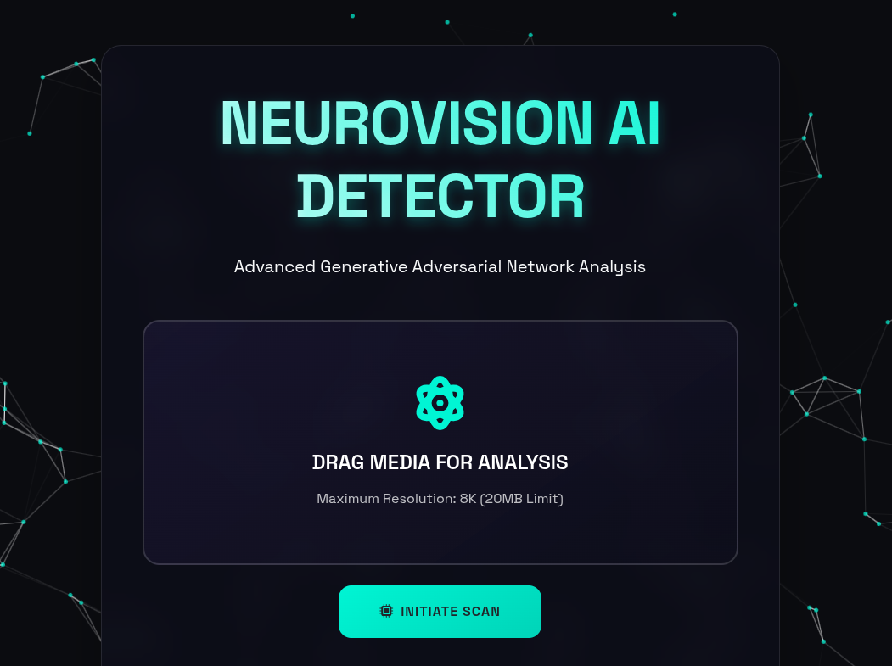
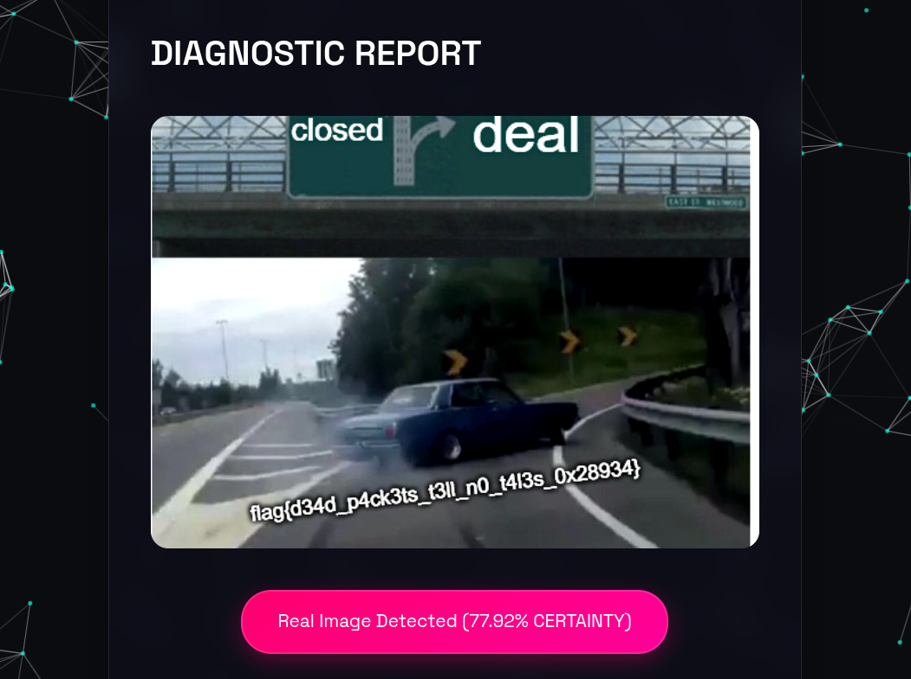

# NeuroVision: Authenticity Detection for AI-Generated Images

## Overview

**NeuroVision** is a research-grade image authenticity detection system designed to distinguish **AI-generated images** from genuine photographs. 
Using a custom-engineered Convolutional Neural Network (CNN), this application captures nuanced visual patterns, spatial inconsistencies, and high-frequency artifacts introduced by synthetic content generators like **GANs** and **diffusion models**.

With rising concerns over misinformation, deepfakes, and synthetic media abuse, NeuroVision offers a scalable solution for **digital media verification**—from journalistic platforms to forensic pipelines.

## Core Highlights

- ⚡️ **Real-time classification** with high-accuracy custom CNN
- 🧠 Model trained on 36,000+ real and fake images from diverse domains
- 📊 Class-wise precision, recall, and AUC monitoring
- 🖼️ Advanced frontend with drag-and-drop image support
- 🐳 Fully containerized with Docker & Docker Compose
- 📁 Clean, modular structure for reproducibility and extension

## Demo


##



## Architecture: Custom CNN

Designed specifically for forensic detection of generative artifacts.

- **Convolutional Backbone:**
  - 4 Conv2D stages with filter progression: 32 → 64 → 128 → 256
  - Each block: Conv2D (5x5 and 3x3) → Batch Normalization → MaxPooling (2x2)
- **Global Feature Aggregation:**
  - Global Average Pooling to reduce spatial maps
- **Classification Head:**
  - Dense(128) → Dense(64) with L2 regularization (λ = 0.001) and Dropout (0.3)
  - Output: 1 neuron with Sigmoid for binary prediction

> Model compiled with Adam (lr = 1e-4), Binary Crossentropy, monitored by Accuracy and AUC. EarlyStopping + LR scheduling applied.

## Dataset

- **Real images:** 18,000+ from public archives and high-res sources like Unsplash
- **Synthetic images:** 18,000+ from GAN pipelines (StyleGAN, BigGAN, Diffusion)
- **Classes:** Real / AI-generated (balanced)
- **Preprocessing:**
  - Resized to 380×380 px
  - Pixel normalization: [0, 1]
  - Augmentations: horizontal flips, small rotations (±10°)

## Performance Benchmarks

- ✅ **Test Accuracy:** 96.22%
- 📈 **AUC:** 0.9908
- 🎯 **Precision/Recall/F1:** All metrics above 0.96 (macro-averaged)
- 🧪 **Misclassification Rate:** 15% on high-fidelity synthetic samples
- 📉 **Training Stability:** Improved with curated real-image enrichment

## Folder Structure

```
ML_Project/
├── flask/
│   ├── app.py
│   ├── models/                 # Trained .keras models
│   ├── static/uploads/         # Uploaded images
│   ├── templates/index.html    # Bootstrap UI
│   ├── requirements.txt
│   └── Dockerfile
├── scripts/                    # Image preprocessing tools
├── notebooks/                  # Model training notebooks
│   └── training_V2.ipynb
├── docker-compose.yml
└── README.md
```

## Local Setup Instructions

1. **Clone Repository**
   ```bash
   git clone https://github.com/B1GM4N18/ML_Project.git
   cd ML_Project/flask
   ```

2. **Create and Activate Virtual Environment**
   ```bash
   python -m venv venv
   source venv/bin/activate
   pip install -r requirements.txt
   ```

3. **Run Flask App**
   ```bash
   python app.py
   ```

4. Open your browser and visit: `http://localhost:5000`

## Docker Deployment

From the root of the project:

```bash
docker-compose up --build
```

Access the application at: [http://localhost:5000](http://localhost:5000)

## Stack and Tools

- **Language:** Python 3.10
- **Frameworks:** TensorFlow, Flask, OpenCV
- **Frontend:** Bootstrap 5, Vanilla JS
- **Deployment:** Docker, Docker Compose

## Research Reference

This project is backed by a research paper:
> *"AI-Generated Image Detection Using Convolutional Neural Networks"*, presented by CSE-IoTCSBT students at VIIT Pune.  
> Includes both architectural comparisons and empirical results using multiple CNN variants.

## What's Next?

- ✅ Dataset Expansion (RSI-Plus): multimodal AI forgeries, document scans
- ✅ Spatial Attention and Transformer-CNN hybrids
- ✅ Lightweight inference with model pruning/quantization
- ✅ Ethical auditing: confidence thresholds, transparency, misuse prevention

## License

Licensed under the **MIT License** — feel free to use with attribution.

## Authors

Developed by B.Tech (IoTCSBT) students at **Vishwakarma Institute of Information Technology**, Pune.
Supervised and reviewed under academic and ethical research standards.